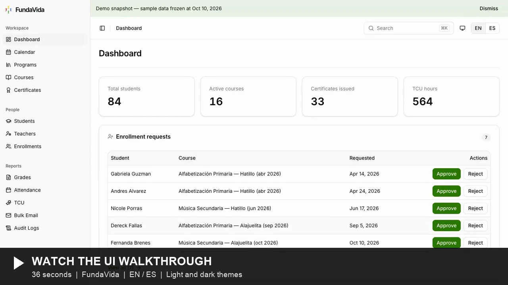
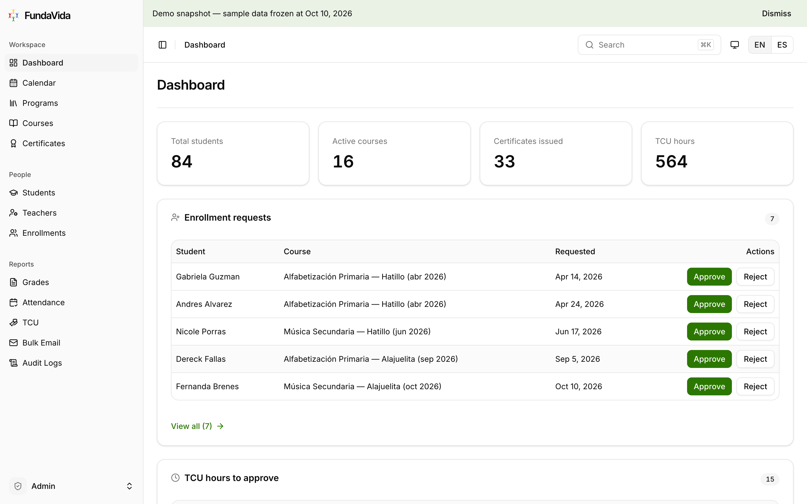
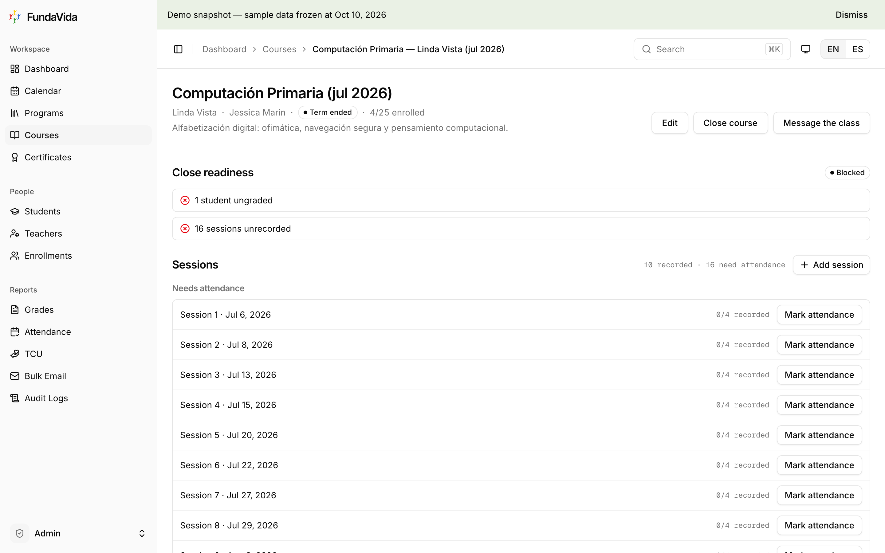
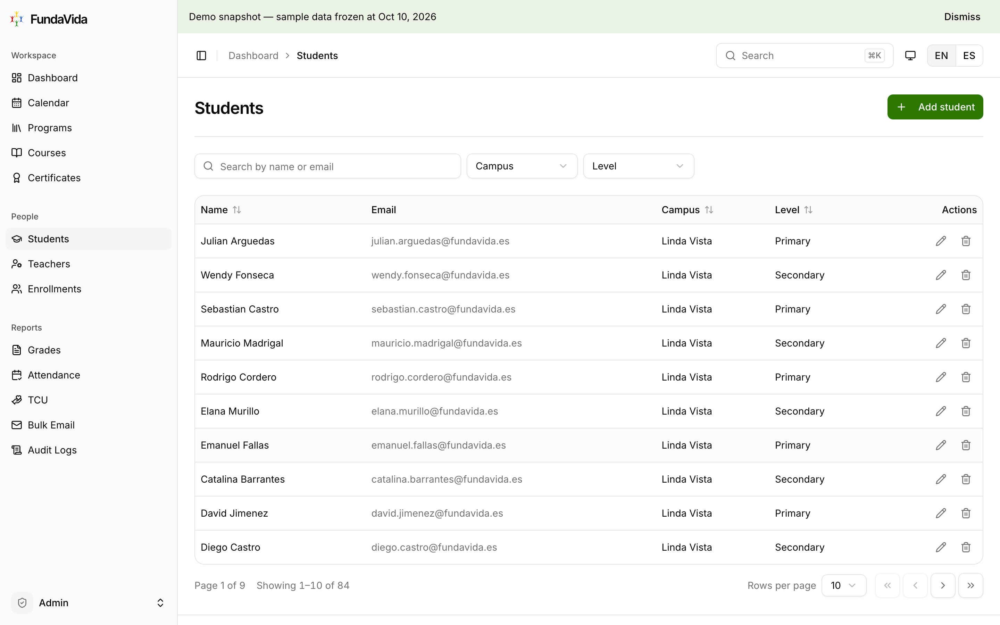
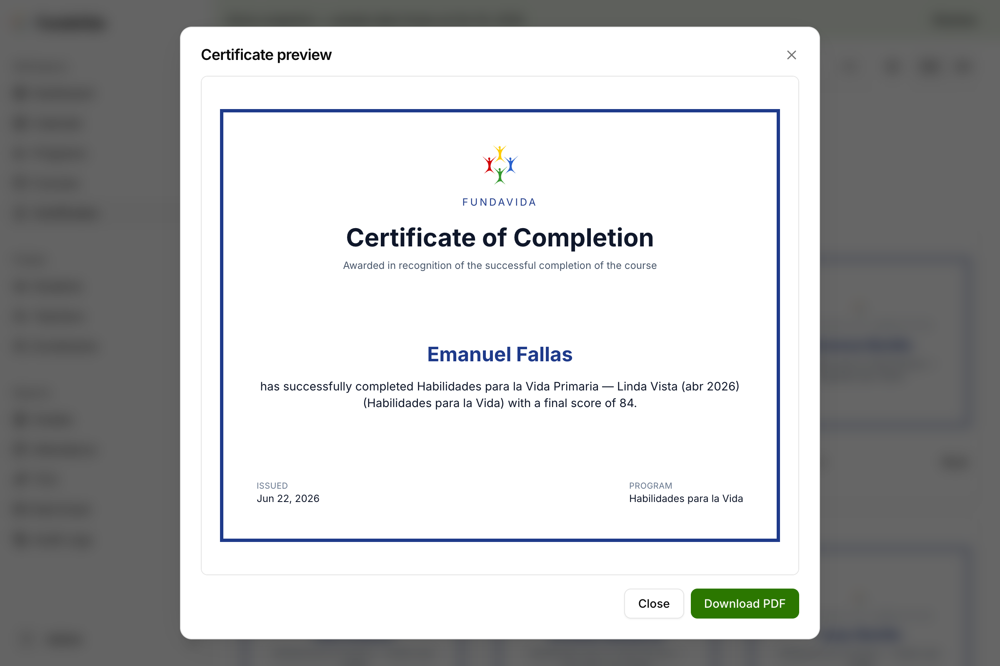
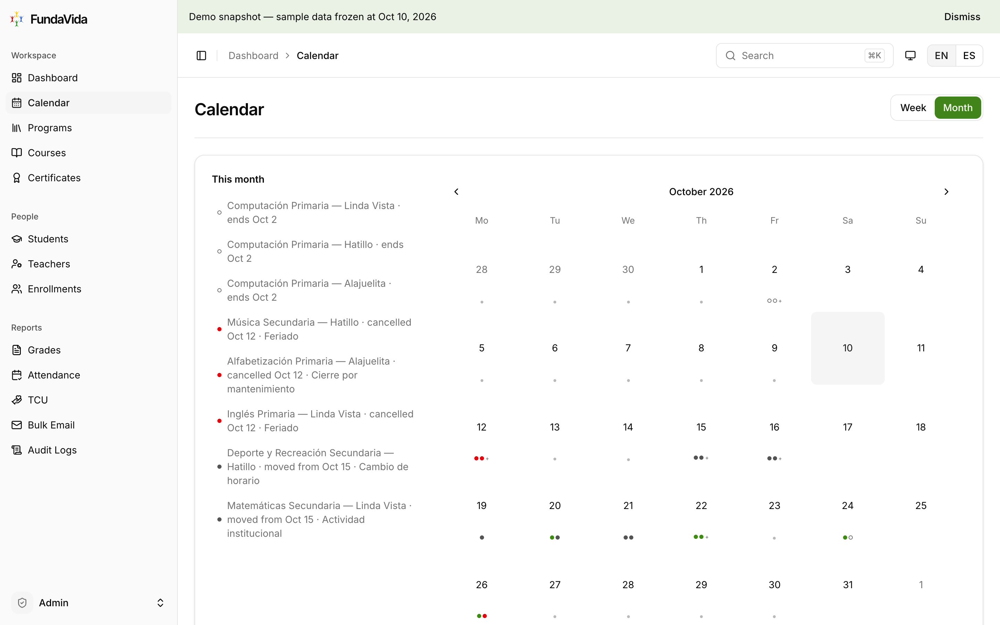
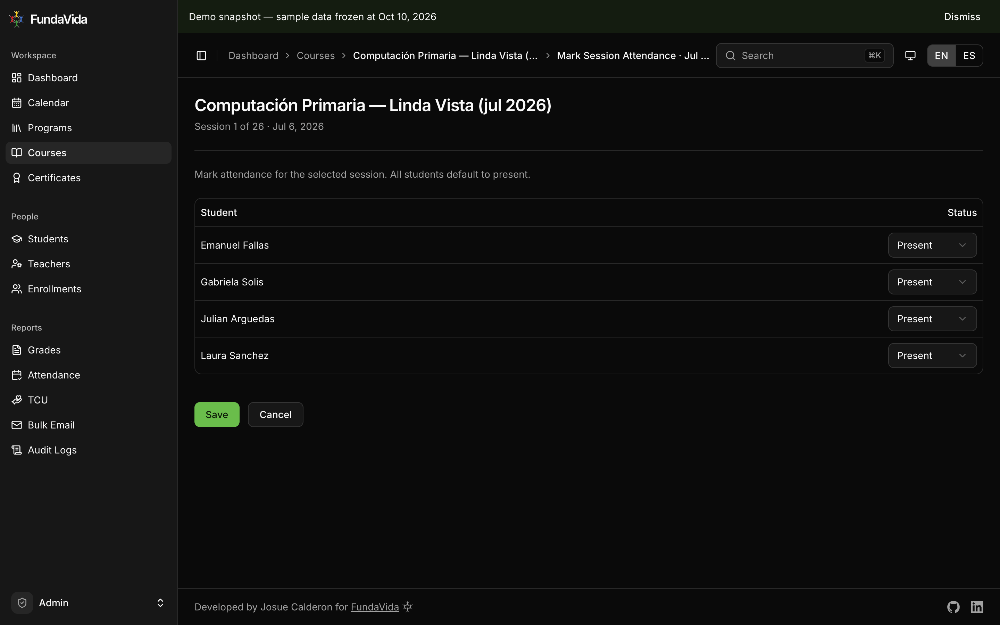
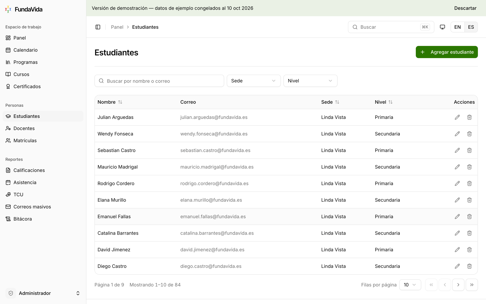

# FundaVida

> Educational management platform — rearchitected as a browser-only portfolio demo.

[](https://fundavida.vercel.app/)
[](https://github.com/rjwrld/FundaVida/actions)

FundaVida was a production educational-management platform built for a Costa Rican non-profit on React + Supabase. This repository is a **portfolio rearchitecture**: all data runs in your browser via `localStorage`, there is no backend, no auth, no secrets. Explore four role-specific workspaces, manage courses and enrollment requests, mark attendance, issue certificates, and log community-service hours. The UI supports English and Spanish, light and dark themes, and responsive layouts.

## Rearchitected from production

| Production (original)     | Portfolio demo (this repo)            |
| ------------------------- | ------------------------------------- |
| Supabase Auth + RLS       | Role switcher (no login)              |
| PostgreSQL + Storage      | Zustand + `localStorage`              |
| Resend email delivery     | Simulated (logged to the audit trail) |
| Vercel + Supabase hosting | Vercel only                           |
| Spanish-only UI           | Bilingual EN / ES (toggle top-right)  |

## Live demo

[**Open the interactive demo →**](https://fundavida.vercel.app/)

[](public/demo/fundavida-walkthrough.mp4)

[**Watch the UI walkthrough →**](public/demo/fundavida-walkthrough.mp4) · 36 seconds · Landing, admin worklists, course details, attendance, certificate preview, English/Spanish, and light/dark themes.


_Admin dashboard — enrollment requests, TCU hours to approve, courses to close, and students at risk._

## Stack

| Layer              | Technology                                       |
| ------------------ | ------------------------------------------------ |
| Framework          | React 19 · TypeScript (strict) · Vite 7          |
| Styling            | Tailwind CSS 4 · shadcn/ui · Radix primitives    |
| State              | Zustand (persisted via `localStorage`)           |
| Data fetching      | TanStack Query                                   |
| Forms & validation | React Hook Form · Zod (t-bound factories)        |
| Routing            | React Router v7                                  |
| i18n               | react-i18next · i18next-parser (CI-gated)        |
| PDF                | @react-pdf/renderer                              |
| Testing            | Vitest · Testing Library · Playwright            |
| CI                 | GitHub Actions · Lighthouse CI · Vercel previews |

## Features

### Four role-specific workspaces

- **Admin** — organization totals and worklists for enrollment requests, TCU hours to approve, courses to close, and students at risk.
- **Teacher** — sessions needing attendance, course closure, enrollment and TCU approval queues, announcements, and an upcoming-session agenda. Course pages hold the roster, grades, class messages, and certificates.
- **Student** — a My courses table with attendance, grades, and certificate downloads; announcements, a calendar, course browsing, enrollment requests, and a personal profile.
- **TCU Trainee** — an assigned course, approved hours toward the 300-hour requirement, pending hours, a paginated activity log, and a Log hours action.

### Course lifecycle

Teachers and admins author courses with a program, campus, term, meeting days, and capacity. Students request enrollment in courses at their own campus; teachers or admins approve the requests. Sessions are derived from the term and meeting days, with cancellation, rescheduling, and extra-session support.

Attendance is marked per session. Once a term ends, the course can be closed after every approved student has a grade and every past session has attendance recorded. Closing issues a certificate to each student with a passing grade (70+). Certificates can be previewed and downloaded as PDFs generated entirely in-browser; there is no separate certificate approval step.

### Supporting tools

- **Students and teachers** — searchable, filtered directories, detail pages, and admin CRUD. Teachers see only students in their own courses.
- **Calendar** — a role-scoped week agenda and a month term map with milestones.
- **Enrollments** — a flat request queue with Pending, Approved, and All filters.
- **Attendance** — an admin course rollup showing attendance rates and unmarked sessions, linking back to each course.
- **Announcements and class messages** — course feeds and simulated email with a sent-message history. Admins also have a bulk-email workspace.
- **TCU** — trainees log their own activities; teachers approve hours for volunteers assigned to their courses, and admins have an organization-wide queue and roster.
- **Audit Logs** — persisted mutation history since the last demo reset.

## Role × capability matrix

Navigation and actions derive from one [permission matrix](src/permissions/matrix.ts); reads are narrowed by role-specific scope tokens. The overview below includes actions inside course pages and dashboards, even when a role has no standalone page for that resource.

| Capability                              | Admin                   | Teacher                                          | Student                                 | TCU                  |
| --------------------------------------- | ----------------------- | ------------------------------------------------ | --------------------------------------- | -------------------- |
| Dashboards and calendar                 | Organization-wide       | Own courses                                      | Enrolled courses                        | Assigned course      |
| Student records                         | CRUD                    | View students in own courses                     | Own profile                             | —                    |
| Teacher directory                       | CRUD                    | —                                                | —                                       | —                    |
| Course authoring and closure            | All courses             | Own courses                                      | —                                       | —                    |
| Course browsing and enrollment requests | Manage all              | Approve in own courses                           | Request / withdraw own pending requests | —                    |
| Grades                                  | Manage all              | Enter / edit after own term ends, before closure | Read own                                | —                    |
| Attendance                              | Mark all                | Mark own courses                                 | Read own                                | —                    |
| Certificate PDFs                        | All issued              | Own courses                                      | Own issued                              | —                    |
| TCU activities                          | Log / approve all       | Approve assigned volunteers                      | —                                       | Log own              |
| Announcements                           | Post / delete all       | Post / delete in own courses                     | Read enrolled courses                   | Read assigned course |
| Simulated email                         | Bulk and class messages | Own class messages                               | —                                       | —                    |
| Audit Logs                              | View                    | —                                                | —                                       | —                    |

See [ADR-0007](docs/adr/0007-permissions-are-one-declarative-matrix.md) for authorization, [ADR-0008](docs/adr/0008-scopefor-returns-tokens-api-interprets.md) for read scopes, and [ADR-0051](docs/adr/0051-each-role-sees-only-its-jobs.md) for the current navigation.

## Scheduling & Demo Epoch

Courses are scheduled via two properties: **Term** (start and end dates) and **Meeting Days** (e.g. Mon/Wed). The app derives the **Session list** (individual class meetings) from these two at read time — the base Sessions are never stored, while exceptions overlay cancellations, rescheduling, and extra sessions (see [ADR-0001](docs/adr/0001-sessions-are-derived-never-stored.md)).

**Demo Epoch**: the demo freezes its clock when the data is seeded, and restores that same clock on return visits. Course terms, session windows, and dashboard worklists share this snapshot until you reset the demo (see [ADR-0014](docs/adr/0014-clock-seam-explicit-demo-epoch.md)).

See [CONTEXT.md](CONTEXT.md) for the complete domain vocabulary (Sede, Educational Level, TCU Trainee, etc.) and the `docs/adr/` directory for the architectural decisions behind each module.

## Screenshots


_Course detail — session worklists, announcements, roster, and course closure._


_Students module — CRUD with search, filters, form validation._


_Certificate preview — PDFs issued when a course closes, ready to download._


_Calendar — month term map with milestone glyphs._


_Attendance — mark a course session in dark mode._

### Bilingual in action

| English                                            | Español                                            |
| -------------------------------------------------- | -------------------------------------------------- |
|  |  |

The interface ships in both locales; `npm run i18n:check` fails CI on any missing translation.

> **Maintenance:** Screenshots, landing thumbnails (`*.thumb.webp`), `public/og-image.png`, and the walkthrough in `public/demo/` are committed assets. Run `npm run screenshots` after changes to a captured surface; it also derives the thumbnails and social card. Use `npm run images:derive` to rebuild only those derived images. Re-record the walkthrough when its featured flows change.

## Getting started

```bash
git clone https://github.com/rjwrld/FundaVida.git
cd FundaVida
npm install
npm run dev
```

Requires Node.js 24. No environment variables required. The demo seeds deterministic data on first load (`faker.seed(42)`).

## Scripts

| Command                 | Description                                                          |
| ----------------------- | -------------------------------------------------------------------- |
| `npm run dev`           | Start Vite dev server                                                |
| `npm run build`         | Typecheck + production build                                         |
| `npm run typecheck`     | `tsc --noEmit`                                                       |
| `npm run lint`          | ESLint (zero warnings allowed)                                       |
| `npm run format`        | Prettier write                                                       |
| `npm run format:check`  | Prettier check (CI-gated)                                            |
| `npm run i18n:extract`  | Extract translation keys via i18next-parser                          |
| `npm run i18n:check`    | Extract + diff; fails if locale files drift                          |
| `npm run test`          | Vitest (unit + component)                                            |
| `npm run test:coverage` | Vitest with coverage report                                          |
| `npm run e2e`           | Playwright end-to-end suite                                          |
| `npm run e2e:ui`        | Playwright UI mode                                                   |
| `npm run screenshots`   | Regenerate landing + README screenshots, thumbnails, and social card |
| `npm run images:derive` | Rebuild thumbnails and social card from existing captures            |

## Project structure

```
src/
├── App.tsx           # App shell & router
├── main.tsx          # Vite entry
├── components/
│   ├── landing/      # Landing-only components (hero, features, tech stack, footer)
│   ├── layout/       # Shared layout (header, sidebar, language toggle)
│   ├── ui/           # shadcn/ui primitives
│   └── [feature]/    # Feature-specific components
├── constants/        # Static configuration
├── data/
│   ├── api/          # Thin hooks atop @tanstack/react-query
│   ├── schemas/      # Zod schema factories (buildXSchema(t))
│   ├── seed/         # Deterministic faker.seed(42) generators
│   ├── persistence.ts # localStorage adapter
│   ├── debounce.ts   # Persistence debouncer
│   └── store.ts      # Zustand root store
├── hooks/            # Custom React hooks (useFormat, useCurrentUser, …)
│   └── api/          # Feature-scoped @tanstack/react-query hooks
├── lib/              # Format helpers, report builders, PDF templates
├── locales/          # en.json + es.json dictionaries + keys.ts parser hints
├── pages/            # Route-level components
└── types/            # Shared TS types
```

## Author

Built by **Josue Calderon** as a portfolio rearchitecture of a college project.

- LinkedIn: [linkedin.com/in/rjwrld](https://www.linkedin.com/in/rjwrld/)
- GitHub: [@rjwrld](https://github.com/rjwrld)

---

<details>
<summary><strong>Sobre FundaVida</strong> — en español</summary>

[**FundaVida**](https://www.fundavida.org/) es una organización sin fines de lucro que trabaja en comunidades de alto riesgo cerca de San José, Costa Rica: Concepción de Alajuelita, 25 de Julio y Linda Vista de Patarrá.

**Misión:** empoderar a jóvenes a través de programas galardonados para superar la violencia, la pobreza y la deserción escolar.

**Programas principales:**

- Centros de Cómputo Interactivos
- Inglés
- Jóvenes con Propósito
- Consejería
- Apoyo Educativo

Este repositorio es una **rearquitectura de portafolio** de una plataforma original construida con React + Supabase para FundaVida. Toda la data corre en tu navegador; no hay backend, ni autenticación, ni secretos. La interfaz está traducida al español y se puede alternar con el botón de idioma en la esquina superior derecha.

> "La esperanza lo cambia todo."

Visita [fundavida.org](https://www.fundavida.org/) para conocer cómo contribuir con donaciones, voluntariado o alianzas.

</details>
